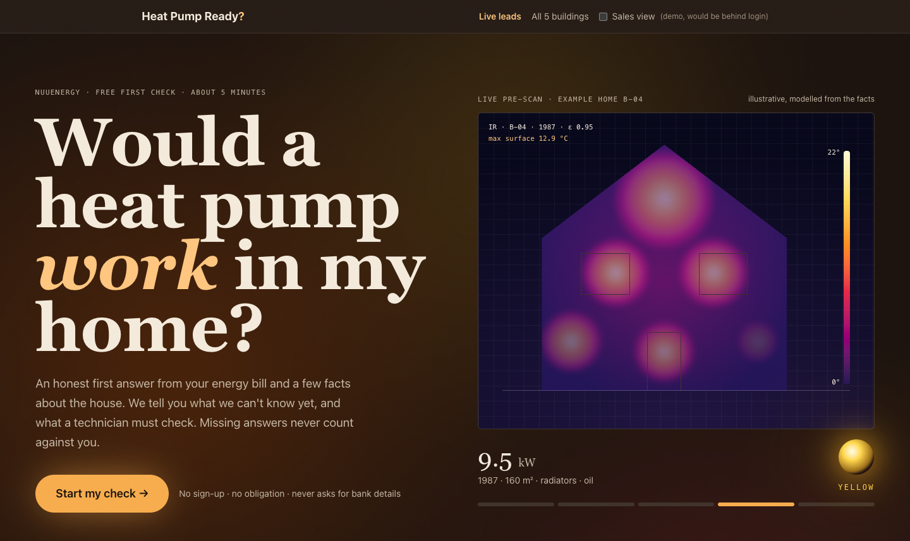
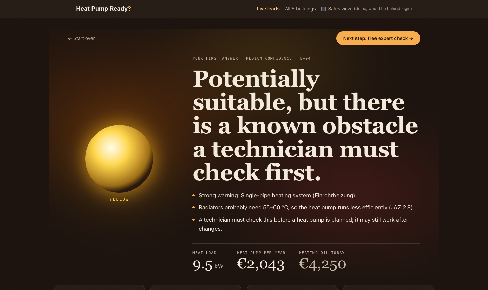
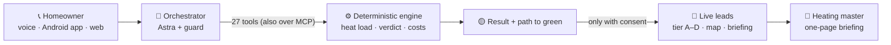
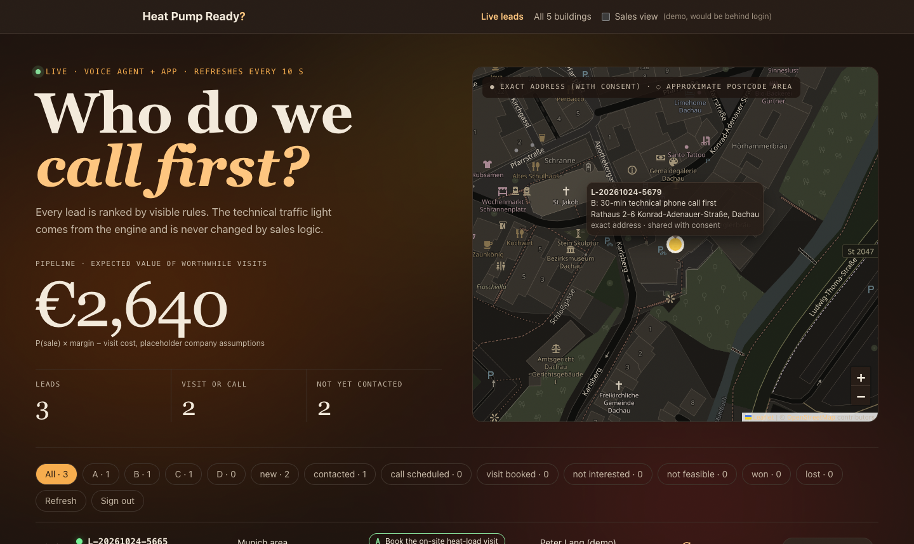
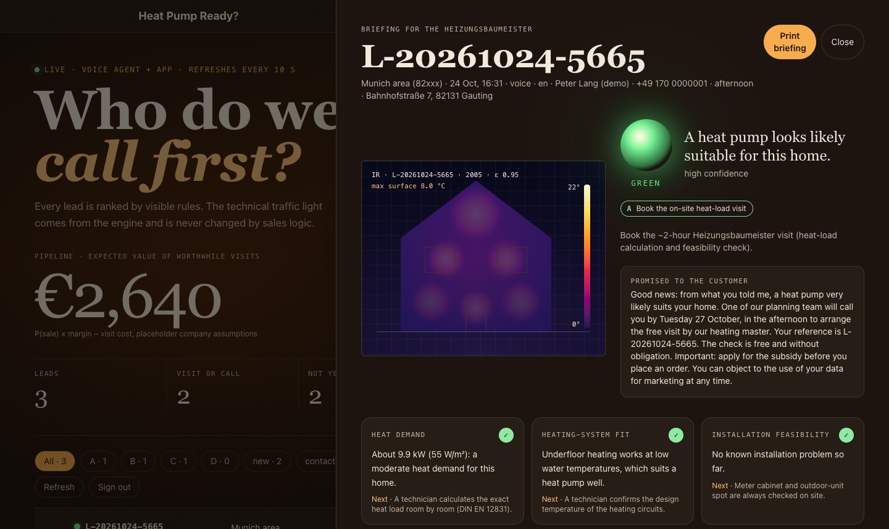
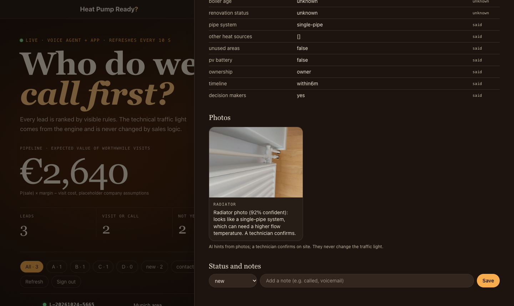

<div align="center">

<a href="https://youtu.be/8AJnO8cEilY"></a>

# Heat Pump Ready?

### Would a heat pump work in your home? **Just call.**

An AI voice agent that gives homeowners an honest heat-pump answer in one phone call,<br>
and tells nuuEnergy's sales team which expert visits are worth driving out for.

[](https://youtu.be/8AJnO8cEilY)
[](submissions/pitch/NoIdea_HeatPumpReady_Pitch.pdf)
[](#team)


**nuuEnergy challenge · Buildings & Everyday Energy · built in one day by Team NoIdea**

</div>

---

## 🔥 The problem

Today a homeowner only finds out whether a heat pump suits their house after an expert drives out for a **two-hour
on-site visit**. That's slow for the homeowner and expensive for the installer, especially for visits that end in "not yet".

## 💡 Our answer

**Pick up the phone.** A patient voice agent asks one question at a time, in plain language, in any of 8 European
languages, and gives an **honest traffic light** in minutes:

| | Verdict | Means |
|---|---|---|
| 🟢 | **Green** | Looks suitable: book the expert visit |
| 🟡 | **Yellow** | Possible, but a technician checks something first (never a hidden "no") |
| 🔴 | **Red** | Major obstacles right now, and what would change that |

Every answer explains itself (heat demand, heating-system fit, installation feasibility, information confidence),
shows yearly running costs vs. today's oil or gas, and a **path to green**.

<div align="center">


</div>

## 🧠 AI talks. Rules decide.

The language model never calculates. It phrases the questions and the explanation; **every number and every verdict
comes from a deterministic engine** built on nuuEnergy's technical guardrails, and a guard rejects any reply that
contains a number the engine didn't produce or changes the verdict.



### Calibrated on nuuEnergy's reference houses

| House | Our estimate | nuuEnergy reference | Verdict (expected) |
|---|---|---|---|
| B-01 | 9.8 kW | 9.6 kW (+2%) | 🟢 green (green) |
| B-02 | 9.9 kW | 9.7 kW (+2%) | 🟢 green (green) |
| B-03 | 16.6 kW | 14.5 kW (+14%) | 🟡 yellow (yellow) |
| B-04 *(hidden by the jury)* | 9.5 kW | – | 🟡 yellow: confirmed single-pipe heating, a technician checks |
| B-05 *(hidden by the jury)* | 10.4 kW | – | 🟡 yellow: the data contradicts itself (216 kWh/m² for a 2006 house) |

Three of three verdicts match. We claim no accuracy beyond these 3 labelled houses.

## ✨ Features

<table>
<tr>
<td width="50%" valign="top">

### 📞 A voice for older homeowners
ElevenLabs voice (Sarah) on our orchestrator as a custom LLM. Calm pace, numbers read back, "I don't know" is
always fine, a human on request, and every call opens with *"nuuEnergy never asks for bank details or passwords."*
Follows the caller in **German, English, French, Italian, Spanish, Dutch, Polish and Portuguese**.

</td>
<td width="50%" valign="top">

### 📸 Photo AI & bill reader
Radiator, meter-cabinet and outdoor-spot photos via an SMS upload link; three independent looks vote, and below 70%
the answer is "a technician checks". Reads yearly gas or oil use from a bill photo or PDF; the caller confirms.

</td>
</tr>
<tr>
<td valign="top">

### 📍 Live leads for the sales desk
*"Who do we call first?"* Every consented lead lands live, ranked into nuuEnergy's own funnel:
**A** book the on-site visit · **B** 30-minute call · **C** ask for info · **D** not now.
Expected value = P(sale) × margin − visit cost, all inputs set by nuuEnergy.

</td>
<td valign="top">

### 🔒 Fair and private
Never asks age, income, health, nationality or bank details. Ranking uses building facts and the homeowner's own
answers only. Exact address on the map **only with consent**, otherwise the postcode area. Lead data sits behind a
sales token.

</td>
</tr>
</table>

<div align="center">

<br>


</div>

## 🛠 The agent's toolbox

27 tools in total (housekeeping included), served to the orchestrator and over MCP. The ones that matter:

| Group | Tool | Does |
|---|---|---|
| Conversation | `get_next_questions` | Only the questions that would change the result |
| | `update_profile` | Stores each answer with its source (caller, bill, photo) |
| | `confirm_details` | Read-back before any result |
| Engine | `assess_building` | Verdict, heat load (two methods), flags |
| | `path_to_green` | Which checks would turn yellow into green |
| | `estimate_costs` | Running costs, price band, subsidy |
| Photo AI | `request_photo_link` · `analyse_photo` | Upload link; radiators, meter cabinet, outdoor spot |
| Explanation | `explain_result` | Plain language, guarded: no new numbers, same verdict |
| Sales | `lookup_location` · `visit_decision` · `finish_session` | Service area, tier A–D, lead (only with consent) |

## 📊 What we measured

| Check | Result |
|---|---|
| Engine vs. reference houses | 3 / 3 verdicts, heat load within +2% / +2% / +14% |
| Live voice test calls (simulated older homeowners, B-02 and B-04) | 2 / 2 correct verdict and heat load, guard never had to step in |
| Radiator photos (installer-labelled, leave-one-out) | 4 / 5 right, 0 confidently wrong |
| Real meter-cabinet / outdoor photos | 2 / 4 exact, 0 confidently wrong |
| Real gas bill (SWM sample) | 12,945 kWh and €765.02 read correctly |
| Plain-language summaries | 5 / 5 kept every number and the verdict |
| Automated tests | 155 passing (core 96, agent 30, orchestrator 26, MCP 3) |

Small samples: read the AI rows as signs, not accuracy figures.

## ⚙️ Tech stack

| Layer | Tech |
|---|---|
| Calculation engine (`packages/core`) | TypeScript, pure functions, no machine learning; Vitest |
| Agent logic (`packages/agent`) | Questions, profile with provenance, state machine, tools, sales reports; SQLite sessions |
| Orchestrator (`services/orchestrator`) | Node.js, `node:http`, `tsx`; HTTP API, number/verdict guard, ElevenLabs custom-LLM bridge |
| Tool server (`services/mcp-tools`) | MCP SDK, stdio or HTTP |
| AI model | OpenAI `gpt-6-astra` (Responses API for tools; vision for photos and PDFs), swappable by config |
| Voice | ElevenLabs Conversational AI, `eleven_flash_v2_5`, live transcripts over WebSocket |
| Web app (`app/`) | React 19, Vite 6, Tailwind CSS 4; "Hearth" theme (Fraunces, Geist, Geist Mono) |
| Map | Leaflet + OpenStreetMap; Nominatim geocoding (consented addresses only) |
| Phone app | Flutter (Android), same backend |
| Demo hosting | Mac mini on Tailscale, public via Tailscale Funnel (**offline since the event ended**) |

## 🚀 Run it

```bash
npm install
npm run dev -w app        # web app → http://localhost:5173 (works without an API key)
npm test                  # engine, agent, orchestrator and MCP tests
```

For the AI helpers, copy `app/.env.example` to `app/.env` and set a key. The assistant backend (orchestrator + MCP
server) runs separately; see [`services/README.md`](services/README.md). **Never commit `.env` files.**

> If the build fails on Windows/Linux with `Cannot find module ../lightningcss.<platform>.node`, delete
> `node_modules` and `package-lock.json` and run `npm install` again (the lockfile has the Mac binaries).

## 🗂 Repo map

| Path | What |
|---|---|
| `app/` | Web app: homeowner check, result, Live leads dashboard, briefing |
| `packages/core/` | Engine, sales logic, AI calls, building data: every number and verdict comes from here |
| `packages/agent/` | Conversation slots, profile, next-question logic, state machine, tools, sales report |
| `services/orchestrator/` | Voice/chat backend: Astra tool loop, guard, HTTP API, ElevenLabs bridge, lead API |
| `services/mcp-tools/` | The same tools as an MCP server |
| `submissions/` | Pitch deck (PDF + sources), demo video pipeline, app download page |
| `docs/` | Specs, prompts, [rule-by-rule sources](docs/REFERENCES.md), [hackathon recap](docs/HACKATHON_RECAP.md) |
| `kit/` | The official challenge kit (buildings, guardrails, labelled photos) |

## 📚 Sources behind the rules

13 public sources, mapped rule by rule in [`docs/REFERENCES.md`](docs/REFERENCES.md), including:
- **Building age never rules a home out:** Fraunhofer ISE monitored 77 heat pumps in existing homes and found no
  correlation between construction year and efficiency.
- **~55 °C is a screening reference, not a wall:** Verbraucherzentrale's rule of thumb.
- **The exact heat load is checked room by room on site:** Umweltbundesamt and nuuEnergy's own process.
- **Questions and photo tasks** follow real installer intake (Enpal, Aira, thermondo).
- **All formulas and prices** come from nuuEnergy's technical guardrails.

## 👥 Team

**Team NoIdea**: Dhruv Mulay · Parth Deshmukh · Pratik Waghmode
Built at **WATT THE HACK Munich 2026** (Munich Climate Week) for the **nuuEnergy** challenge, with Claude Code.

The 5 buildings, photos and guardrail values are from nuuEnergy's challenge kit. Map data © OpenStreetMap contributors.

<div align="center">
<br>
<b><i>Fewer wasted visits. More homes that say yes.</i></b>
</div>
